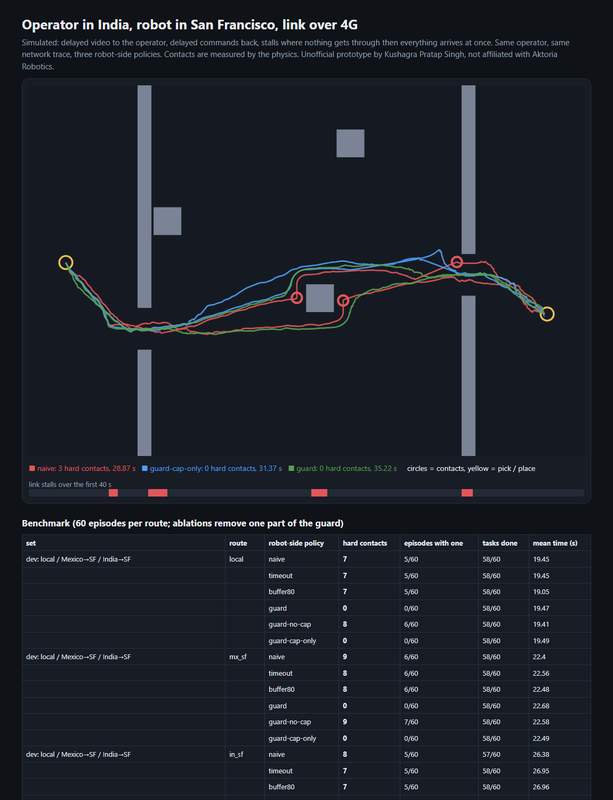

# Teleop latency guard: what the robot should do when the India → SF link hiccups

> Unofficial prototype by Kushagra Pratap Singh. Not affiliated with Aktoria Robotics. Everything is simulated; the route numbers are assumptions in the range Aktoria states, not measurements of their network.

## The problem

Aktoria runs teleop with trained operators in India and Mexico for robots deployed elsewhere: "~5 ms local, ~130 ms India to San Francisco. Any robot." ([aktoria.com](https://aktoria.com)). The 130 ms average is fine. What hurts are the moments it isn't 130 ms:
- jitter spikes;
- loss bursts;
- **stalls** (Wi-Fi/4G handover, bufferbloat), where nothing gets through for 0.3–1.5 s and then everything queued arrives at once.

During a stall the robot either keeps executing a command the operator would have changed, or it gets a burst of stale commands. Meanwhile the operator is staring at a frozen frame.

The question a customer will ask about a remote-operator service: **what does the robot itself do then?**

## What I built

`teleguard`: a robot-side policy for timestamped command packets, plus a simulator to score it.

**Simulator** (`sim.py`, `net.py`, `world.py`):
- A 2D table with walls and narrow gaps (7.5–14 cm), and a pick-and-place task out and back.
- Speed and acceleration limits.
- Physics measures every contact and its impact speed; hard = over 5 cm/s.
- Video goes down a delayed link, commands come up the same route.
- Routes: local, Mexico→SF, India→SF. Held-out: India→SF over 4G, and a lossy Wi-Fi hop.
- **Operator model:** a trained remote operator who knows the usual lag (the UI shows it). They slow down to keep blind travel within a budget and react about 0.2 s after a frame arrives. They adapt to the **average** lag, not to a spike, which is the realistic failure.

**Policies** (`policies.py`):

| policy | what it does with packets |
|---|---|
| naive | executes the newest packet to arrive, even an older one |
| timeout | newest by sequence number, stops after 200 ms of silence |
| buffer80 | fixed 80 ms playout buffer, then like timeout |
| **guard** | **age-aware:** drops stale (> 300 ms) and out-of-order packets; playout delay = p95 of recent ages; dead-man stop when the playing command goes stale; **clearance cap:** limits speed toward the nearest obstacle to `v·L + v²/2a ≤ clearance`, where L is the measured loop delay (uplink + video back + reaction) |
| guard-no-cap / -no-deadman / -cap-only | ablations, part of the frozen run |



## Results

60 episodes per route. Same layout, operator and network trace for every policy in an episode. Mean time is counted on episodes every policy finished.

**Held-out first run** (routes, narrower gaps and three operator styles **committed to git before the first run**):

| route | naive | timeout | buffer80 | **guard** | guard-no-cap | **guard-cap-only** |
|---|---|---|---|---|---|---|
| India→SF: hard contacts | 16 | 16 | 16 | **0** | 16 | **0** |
| tasks done / mean time | 56 · 31.6 s | 56 · 32.1 s | 56 · 32.1 s | 56 · 32.8 s | 56 · 32.3 s | 55 · 32.0 s |
| India→SF 4G: hard contacts | 26 | 19 | 18 | **0** | 15 | **0** |
| tasks done / mean time | 51 · 34.1 s | 50 · 35.4 s | 50 · 35.5 s | **47** · 36.8 s | 48 · 36.1 s | 50 · 34.4 s |
| Wi-Fi hop: hard contacts | 16 | 16 | 17 | **0** | 16 | **0** |
| tasks done / mean time | 56 · 29.8 s | 57 · 31.0 s | 57 · 31.0 s | 55 · 33.3 s | 56 · 32.9 s | 57 · 30.1 s |

Dev (local / Mexico→SF / India→SF): 7–9 hard contacts for the baselines and 0 for the guard, with 0–4% more task time.

**What the ablations say:**
- **The clearance cap prevents the contacts.** Without it (guard-no-cap), contacts are back at baseline levels. The cap is latency-aware: it is tighter when the measured loop delay is longer.
- **Stale rejection and the dead-man stop matter only on the stall-heavy 4G link** (26 → 15 contacts without the cap). Elsewhere they changed nothing in this model.
- **The dead-man stop has a cost.** On 4G the full guard finished 47/60 tasks against 51 for naive and 50 for cap-only, because frequent stops slow the operator down. On this held-out set, the best trade-off is **cap-only: 0 hard contacts, the same completions as the baselines, +1% time**. That is a finding from the frozen run, not something I tuned afterwards.

**Limits:**
- 2D point-mass end effector, not a real arm or humanoid. No video codec model; the operator sees the true state, delayed.
- The operator model is mine. Real operators will differ, and their behaviour under freezes matters most.
- The cap needs the robot to know the clearance to the nearest obstacle (a local map or depth sensing). Unknown obstacles aren't covered.
- Clocks are assumed NTP-synced to about 1 ms, so a packet's age is measurable.

## Run it

```
python demo.py                # one 4G episode, three policies -> out/report.html
python evaluate.py heldout    # or: dev (~3 min each)
python -m pytest -q           # 7 tests
```

Python 3.10+, standard library only (pytest for tests).
